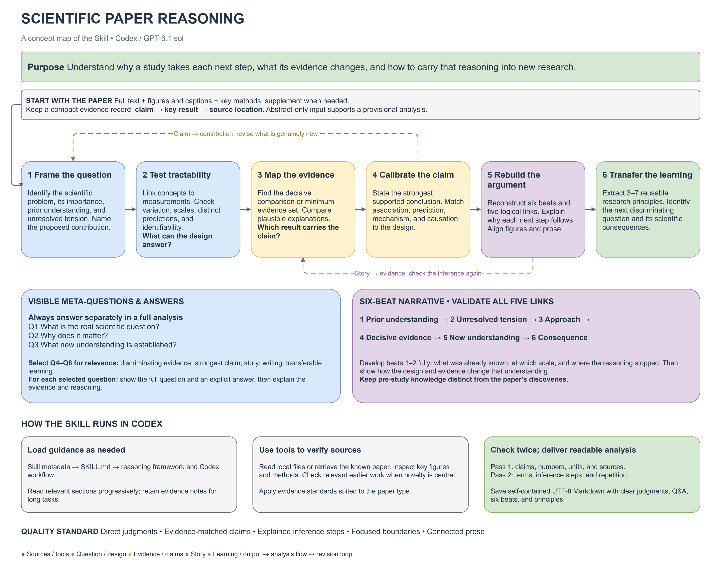

# Scientific Paper Reasoning

An evidence-grounded Codex Skill for deeply understanding scientific papers and developing research judgment.

**[中文说明与中文概念图](README.zh-CN.md)** · [Skill instructions](skills/scientific-paper-reasoning/SKILL.md) · [Reasoning framework](skills/scientific-paper-reasoning/references/scientific_reasoning_framework.md)

## Purpose

Scientific Paper Reasoning helps researchers understand **why a study takes each next step and what its evidence changes**. It reconstructs the scientific question, the design choices, the decisive comparisons, and the resulting change in understanding. Readers can then use that reasoning in their own research.

The guiding question is: **Why must the authors take the next step?** A strong argument makes the next question, analysis, or experiment follow naturally; the answer can still be surprising.

The Skill is designed for the **Codex / GPT-6.1 sol** environment. Model selection, reasoning effort, and available tools remain settings of the host application. The instructions define how to analyze evidence and communicate the result.

## Concept map



[Open the full-resolution image](assets/scientific-paper-reasoning-concept.drawio.png) · [SVG](assets/scientific-paper-reasoning-concept.svg) · [Editable draw.io source](assets/scientific-paper-reasoning-concept.drawio)

## How it works

The reasoning framework connects:

**Question → Importance → Tractability → Contribution → Evidence → Claim → Story → Writing → Meta-learning**

The practical workflow has six steps:

| Step | What the analysis establishes |
| --- | --- |
| 1. Frame the question and tension | The central scientific question, why it matters, what was known before the study, and where the existing understanding stops. |
| 2. Test tractability | Whether concepts correspond to measurements, relevant variation and scales are present, and the design can distinguish the predictions being discussed. |
| 3. Build the evidence architecture | The decisive comparison or minimum necessary evidence set. Removing a key result should reveal how much the central claim depends on it. |
| 4. Calibrate the claim | The strongest affirmative conclusion supported by the design and results, with association, prediction, mechanism, causation, and extrapolation distinguished where they change the interpretation. |
| 5. Reconstruct the argument | The six-beat narrative and its five logical connections, including why each next question or analysis becomes necessary. |
| 6. Extract transferable learning | The argumentative roles of figures and text, 3–7 reusable research principles, and the next discriminating question. |

Two feedback loops keep the analysis coherent: **claim → contribution** revises the proposed contribution to match what the evidence supports; **story → evidence** checks whether the narrative’s key inferences actually follow from the results.

Evidence standards depend on the paper. Observational studies, mechanism experiments, theoretical papers, and syntheses require different kinds of support. A crucial result can be an observation, intervention, derivation, or combination of evidence.

## What the reader receives

A full analysis begins with a clear central judgment. It then explicitly presents and answers:

1. **Meta-question 1: What is the real scientific question?**
2. **Meta-question 2: Why does it matter?**
3. **Meta-question 3: What new understanding is established?**

Questions 4–8 are selected for their relevance to the paper: discriminating evidence, the strongest supported claim, the scientific story, how the reasoning is written, and transferable learning. Each selected question is displayed in full, followed by an explicit **Answer** and developed reasoning.

The six-beat reconstruction explains the progression:

**Prior understanding → Unresolved tension → Approach → Decisive evidence → New understanding → Consequence**

The first two beats receive enough detail to make the design understandable. The analysis keeps pre-study knowledge separate from discoveries made by the paper, explains the inference between results and conclusions, and uses connected prose. Clear judgments come first; a consequential boundary is explained where it affects the claim.

When requested, the deliverable is a self-contained Markdown file with source locations for the key evidence.

## Install

### Through Codex’s Skill Installer

Ask Codex:

```text
$skill-installer Install the skill from:
https://github.com/yinwen-ecology/scientific-paper-reasoning/tree/main/skills/scientific-paper-reasoning
```

### Manual installation

Copy the entire `skills/scientific-paper-reasoning` folder, including `references`, into a skill location supported by your Codex version. The current official documentation lists `~/.agents/skills` for user skills and `.agents/skills` for project skills.

For example, on Windows with PowerShell:

```powershell
git clone https://github.com/yinwen-ecology/scientific-paper-reasoning.git scientific-paper-reasoning-repo
New-Item -ItemType Directory -Force -Path "$HOME/.agents/skills" | Out-Null
Copy-Item -Path "./scientific-paper-reasoning-repo/skills/scientific-paper-reasoning" -Destination "$HOME/.agents/skills/" -Recurse
```

Use one installation location to avoid duplicate entries. If the Skill does not appear, restart Codex. See the [official Skill documentation](https://learn.chatgpt.com/docs/build-skills) for discovery locations and installation behavior.

## Use

Provide a local paper, DOI, publisher URL, or pasted text. Full text, figures, captions, and relevant methods support the deepest analysis. If only an abstract is available, the analysis stays within what that material supports.

```text
$scientific-paper-reasoning
Analyze the attached paper in English. Explicitly answer meta-questions 1–3,
select other questions that matter for this paper, and reconstruct the six-beat
reasoning. Explain the key comparisons and how they change our understanding.
Save the complete analysis as Markdown.
```

You can also request a focused analysis of a design choice, a decisive figure, a claim, or a weak logical connection. The instructions are currently written in Chinese; the output language can be requested explicitly.

## Repository contents

```text
scientific-paper-reasoning/
├── README.md                          English overview
├── README.zh-CN.md                    中文说明
├── skills/
│   └── scientific-paper-reasoning/
│       ├── SKILL.md                   Entry point and output requirements
│       └── references/
│           ├── scientific_reasoning_framework.md
│           └── codex_workflow.md
└── assets/                            English and Chinese concept maps
```

The reasoning reference defines meta-questions, six beats, evidence criteria, and writing guidance. The Codex reference covers source retrieval, figure verification, evidence notes, long-document continuity, and delivery. The Skill itself requires no executable scripts or Python packages; paper retrieval and document inspection use the tools available in the host environment.
