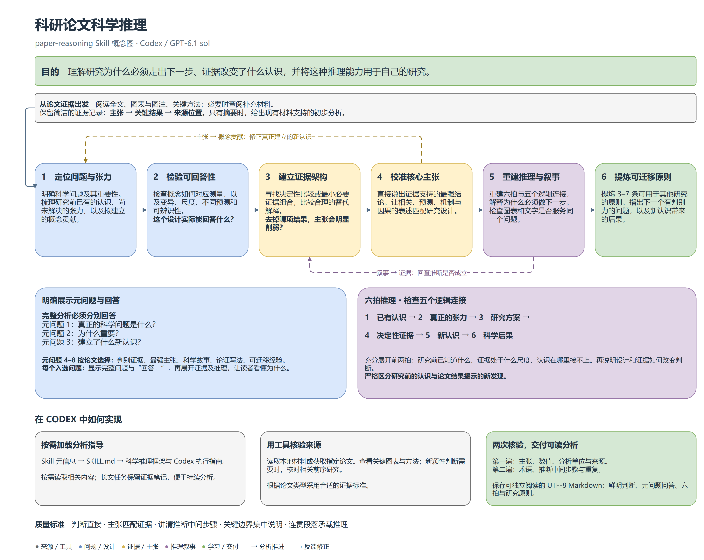

# 科研论文科学推理

`paper-reasoning` 是用于科研论文深度理解与科研判断训练的独立跨学科 Codex Skill。

**[English overview and concept map](README.md)** · [Skill 指令](skills/paper-reasoning/SKILL.md) · [科学推理框架](skills/paper-reasoning/references/scientific_reasoning_framework.md)

## 目的

这个 Skill 帮助科研人员理解：**研究为什么必须走出下一步，证据改变了什么认识，以及这种推理如何用于自己的研究。** 分析围绕科学问题、研究设计、关键比较与认识更新展开，让读者看懂作者为什么这样做、哪项证据最有分量、真正建立了什么新认识。

它的核心追问是：**作者为什么必须做下一步？** 好的科学论证让下一个问题、分析或实验自然出现，答案则可以出乎意料。

本 Skill 针对 **Codex / GPT-6.1 sol** 环境设计。模型选择、推理强度和可用工具由客户端决定；Skill 规定如何分析证据、组织推理并交付读者看得懂的结果。

## 中文概念图



[查看高清图片](assets/paper-reasoning-concept-zh.drawio.png) · [SVG 矢量图](assets/paper-reasoning-concept-zh.svg) · [draw.io 可编辑源文件](assets/paper-reasoning-concept-zh.drawio)

## 原理与技术路线

框架的主链是：

**科学问题 → 重要性 → 可回答性 → 概念贡献 → 证据 → 主张 → 科学故事 → 论证写作 → 可迁移经验**

实际分析分为六步：

| 步骤 | 要讲清的内容 |
| --- | --- |
| 1. 定位问题与张力 | 真正的科学问题是什么，为什么重要；研究前已知道什么，已有认识在哪里接不上。 |
| 2. 检验可回答性 | 概念怎样对应测量，变异与尺度是否合适，不同解释是否产生可区分的预测，设计实际能回答多少。 |
| 3. 建立证据架构 | 哪个比较或最小必要证据组合支撑核心主张；删掉哪项结果，主张会明显削弱。 |
| 4. 校准核心主张 | 用肯定句说出证据支持的最强结论，让相关、预测、机制、因果和外推的表述匹配设计与结果。 |
| 5. 重建推理与叙事 | 展开六拍，检查五个逻辑连接，解释为什么下一问或下一项分析变得必要。 |
| 6. 提炼可迁移原则 | 检查图表与文字的论证作用，提炼 3–7 条可用于其他研究的原则，并提出下一个有判别力的问题。 |

两个反馈环节贯穿分析：**主张 → 概念贡献**，用证据真正支持的结论修正拟建立的新认识；**叙事 → 证据**，回查故事中的关键推断是否由结果支持。

证据标准随论文类型调整。观测发现、机制实验、理论推导和综合研究各有不同的判断依据。关键证据可以来自观察、干预、推导或多项证据的组合。

## 输出是什么样的

完整分析先给出鲜明的总判断，再分别展示和回答三个元问题：

1. **元问题 1：真正的科学问题是什么？**
2. **元问题 2：为什么重要？**
3. **元问题 3：建立了什么新认识？**

元问题 4–8 根据论文选择，涉及判别证据、最强主张、科学故事、论证写法和可迁移经验。每个入选问题都显示完整问题，以 **“回答：”** 开始，随后展开关键证据及其推理。篇幅由理解所需的内容决定。

六拍则解释认识如何推进：

**已有认识 → 真正的张力 → 研究方案 → 决定性证据 → 新认识 → 科学后果**

前两拍充分交代研究开始前的知识结构和悬念，让后面的设计有来由。分析严格区分先验认识与论文的新发现，解释指标的含义、作者比较了什么、结果为何改变判断，并用连贯段落承载推理。观点直接，关键边界集中放在影响结论的位置说明。

用户要求文件时，交付可独立阅读的完整 Markdown，并为核心证据保留图号、方法或结果位置。

## 安装

### 通过 Codex 的 Skill Installer

向 Codex 输入：

```text
$skill-installer 请安装以下 GitHub 路径中的 Skill：
https://github.com/yinwen-ecology/paper-reasoning/tree/main/skills/paper-reasoning
```

### 手动安装

将 `skills/paper-reasoning` 整个文件夹复制到当前 Codex 版本支持的 Skill 目录，保留其中的 `references`。当前官方文档列出的用户目录是 `~/.agents/skills`，项目目录是 `.agents/skills`。

Windows PowerShell 示例：

```powershell
git clone https://github.com/yinwen-ecology/paper-reasoning.git paper-reasoning-repo
New-Item -ItemType Directory -Force -Path "$HOME/.agents/skills" | Out-Null
Copy-Item -Path "./paper-reasoning-repo/skills/paper-reasoning" -Destination "$HOME/.agents/skills/" -Recurse
```

选择一个安装位置，避免出现重复条目。如果未显示，重启 Codex。目录和发现方式见 [官方 Skill 文档](https://learn.chatgpt.com/docs/build-skills)。

## 使用

提供本地论文、DOI、出版社链接或粘贴文本。完整正文、图表、图注与关键方法能支撑深入分析；只有摘要时，回答以现有材料能够支持的内容为准。

```text
$paper-reasoning
请深度分析这篇论文，使用中文。分别列出并回答元问题 1–3，
按论文内容选择其他值得回答的问题，充分展开六拍。
解释关键指标、比较对象和结果如何改变认识，
最后保存为完整 Markdown 文件。
```

也可以集中追问某项设计、某张关键图、一个核心主张或一处薄弱的逻辑连接。Skill 指令目前以中文编写，可在调用时指定英文或其他输出语言。

## 仓库文件

```text
paper-reasoning/
├── README.md                          英文主页
├── README.zh-CN.md                    中文说明
├── skills/
│   └── paper-reasoning/
│       ├── SKILL.md                   入口指令与输出要求
│       └── references/
│           ├── scientific_reasoning_framework.md
│           └── codex_workflow.md
└── assets/                            中英文概念图
```

科学推理参考文件包含元问题、六拍、证据判据和行文指导；Codex 执行指南处理来源获取、图表核验、证据记录、长文连续分析与文件交付。Skill 本身没有执行脚本，也不依赖 Python 包；论文获取与文档查看使用当前环境提供的工具。
